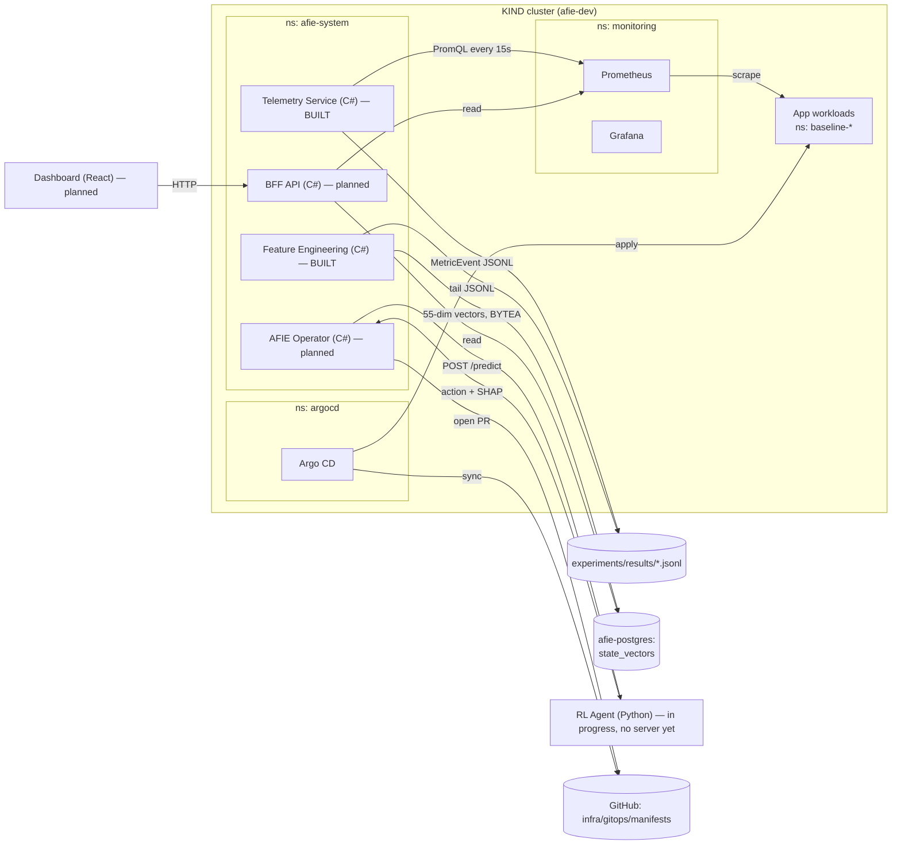
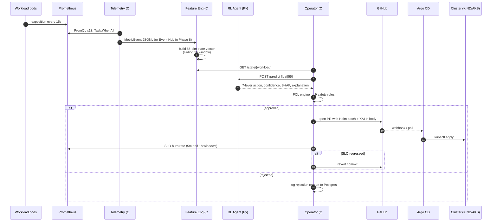

# System Architecture

## 1. Overview

AFIE closes a control loop over a Kubernetes cluster: it reads live workload
telemetry, decides whether resource requests/limits should change, validates
that decision against safety rules, and applies changes through Git so every
action is auditable and reversible.

The system is split into six independently deployable components and one
shared observability stack. Telemetry and feature engineering are built, the
RL agent is partly built, and the rest are described here as designed so the
architecture is coherent end-to-end. Status is in [README.md](README.md).

## 2. High-level architecture

Legend: solid edges are implemented today wherever both endpoints are marked
BUILT; edges touching a `planned` node are the designed contract, not
runtime behaviour.

## 3. Components

| # | Component | Language / stack | Phase | Status | Purpose |
| - | --- | --- | --- | --- | --- |
| 1 | Telemetry Service | ASP.NET Core 8 | 3 | Built | Scrape Prometheus every 15s, publish `MetricEvent`s |
| 2 | Feature Engineering | ASP.NET Core 8 + MathNet + Npgsql | 4 | Built | 55-dim state vector via `/state/{workload}`; 60s emitter persists to Postgres |
| 3 | RL Agent | Python 3.11, Stable-Baselines3; SHAP + FastAPI planned | 5 | In progress | Environments and offline PPO trainer built; `POST /predict` and explanations planned |
| 4 | AFIE Operator | .NET 8 + KubeOps + Octokit | 6 | Planned | Reconcile `ResourceRecommendation` CRDs, run PCL, open PRs |
| 5 | BFF API | ASP.NET Core 8 | 7 | Planned | Aggregate Postgres audit log + Prometheus for the UI |
| 6 | Dashboard | React 18 + Vite + shadcn/ui | 7 | Planned | Cost, action history, XAI, SLO heatmap, override |
| — | Observability | kube-prometheus-stack + Grafana | 2 | Built | Metrics store used by every component |
| — | GitOps | Argo CD (Flux planned as an alternative) | 2 | Built | Applies committed manifests to the cluster |

## 4. Data flow (target design, all phases live)

## 5. The 55-dimensional state vector

The RL agent's observation space is `Box(-1, 1, shape=(55,))`. Feature
engineering produces the vector from live `MetricEvent`s. Training will use the
Azure Public Dataset V2 (VM traces 2019), but the conversion script to this schema does not exist
yet. Feature names live in
[`feature_names.py`](../src/ml/afie_ml/feature_names.py).

| Dims | Group | Content |
| --- | --- | --- |
| 0–8 | CPU | usage / limit, {P50, P95, P99} over 5m / 15m / 1h |
| 9–17 | Memory | same layout |
| 18–23 | App signals | req/s, error rate, P50/P95/P99 latency (5m), one reserved |
| 24–26 | Node pressure | CPU pressure, memory pressure, eviction proximity |
| 27–29 | Cost | $/hr estimate, 7-day trend, budget fraction |
| 30–34 | Temporal | sin/cos hour, sin/cos day-of-week, age of latest sample |
| 35–37 | Deployment | replica count, HPA target, rolling-update flag |
| 38–46 | Action history | last 3 actions × (cost Δ, SLO Δ, time since) |
| 47–52 | Cloud pricing | spot ratio, reservation coverage, storage access freq, region price index, commitment available, is-stateful |
| 53–54 | Region migration | cheaper-region price index, cross-region P99 baseline |

**Not yet live:** dim 23 is reserved; 28 and 35–37 are placeholders; 38–46 stay
zero because nothing records actions; 47–54 come from static configuration. CPU
pressure is a utilisation threshold (see
[telemetry-service.md §3.3](telemetry-service.md#33-prometheusqueries)).

Cyclic encoding on temporal dims is load-bearing: hour 23 must be adjacent
to hour 0 in feature space. The C# builder clamps to `[-2, 2]` and coerces
NaN/Inf to zero; the Python environments clip to `[-1, 1]`.

Forecast features are not part of this vector. They are planned as four more
dimensions (59).

> **Note on CPU/Memory dims (0–8, 9–17).** Each 9-slot group is
> `{P50, P95, P99} × {5m, 15m, 1h}` of `usage / limit` —
> `CpuUsageRate / max(CpuLimit, ε)` for CPU and
> `MemoryBytes / max(MemLimit, ε)` for memory. `CpuRequest`, `CpuLimit`,
> `MemRequest`, `MemLimit` from `MetricEvent` are used as normalisation
> denominators, not as standalone dimensions. This is what makes the
> 55-total arithmetic add up (9 + 9 + 6 + 3 + 3 + 5 + 3 + 9 + 8 = 55).

## 6. Action space and reward

**Action space:** `MultiDiscrete([5,5,3,3,3,2,3])`, 4,050 joint actions
([`actions.py`](../src/ml/afie_ml/actions.py)).

| Dim | Lever | Options |
| --- | --- | --- |
| 0 | CPU adjustment | −20, −10, 0, +10, +20 % |
| 1 | Memory adjustment | −20, −10, 0, +10, +20 % |
| 2 | Instance lifecycle | on-demand, reserved-1yr, spot |
| 3 | Commitment plan | none, savings-plan-1yr, savings-plan-3yr |
| 4 | Storage tier | hot, cool, archive |
| 5 | Scheduling | always-on, off-hours scale-down |
| 6 | Region | stay, cheaper same continent, cheapest global |

**Reward** ([`reward.py`](../src/ml/afie_ml/reward.py)):

`R = 0.30·cost + 0.20·cloud_savings + 0.10·region_savings + 0.20·slo + 0.08·carbon − 0.05·egress − 10·violations`

The positive terms sum to at most 0.88, so one violation always dominates. The
inputs come from a training-time heuristic
([`heuristic.py`](../src/ml/afie_ml/heuristic.py)), not from measured cost or
SLO data.

## 7. Policy Constraint Language (PCL)

**Planned (Phase 6).** Every action will pass nine rules before the operator
opens a PR:

| Rule | Check |
| --- | --- |
| R1 | CPU and memory adjustment ≤ 20% |
| R2 | New limit ≥ P99 usage × 1.10 |
| R3 | No rolling update in progress |
| R4 | 30-minute cooldown per workload |
| R5 | No spot for stateful workloads |
| R6 | Reserved capacity ≥ 30% of the 7-day baseline |
| R7 | Region move only if P99 ≤ current + 20 ms |
| R8 | Storage downgrade only if access < 0.01/h for 7 days |
| R9 | No cheapest-global move for stateful or data-residency-tagged workloads |

R1, R2 and R5 are to be mirrored in a Kubernetes `ValidatingAdmissionPolicy`.
The PCL is deliberately simple and boundary-testable: it is the audit boundary
a reviewer or SRE can read in one page. Today only the training reward
penalises headroom and stateful spot / global-move violations.

## 8. GitOps backend abstraction

The operator writes plain rendered manifests to
`infra/gitops/manifests/{workload}.yaml`. Both Argo CD (`Application`) and
Flux (`Kustomization`) can sync the same path. An `IGitOpsBackend`
abstraction (`ArgoBackend`, `FluxBackend`, `DirectApplyBackend`) hides the
difference — the SLO verifier uses it to poll for sync + apply completion
before the burn-rate check that decides on rollback. All of this is planned.

Never run Argo CD and Flux against the same path in the same cluster.

## 9. Deployment topology

**Development (Phases 1–7, current):** everything runs on a single KIND
cluster on the developer's MacBook. Cost: $0. Telemetry writes JSONL to a
shared `ReadWriteOnce` PVC in `afie-system`; feature engineering mounts
the same PVC read-only and consumes the files. Persisted state vectors
land in a single-replica `afie-postgres` StatefulSet with a 5Gi PVC. Both
service pods must co-locate on the same node (RWO PVC constraint),
enforced by pod affinity. The RL agent is planned as a local FastAPI process on
`localhost:5001`; the dashboard runs on Vite dev server at
`localhost:5173`.

**Production (Phases 8–9, planned):** Azure Event Hub replaces the file
sink for telemetry; Cosmos DB replaces Postgres for the audit log; Azure ML
optionally replaces the local inference server (falls back to the local server
if the student subscription blocks it); Static Web Apps hosts the
dashboard. AKS is *not* used — the student subscription blocks it — so
the cluster stays on KIND for experiments and moves to any managed
Kubernetes only if the block is lifted. Migration is a redeploy of the
same manifests.

## 10. Technology choices — why

- **KubeOps** for the operator over Metacontroller / bare `client-go`: it
  gives idiomatic C# CRD controllers with generated typed clients, so the
  operator can share models with the telemetry service.
- **Stable-Baselines3 PPO** over a hand-rolled implementation: the paper's
  contribution is the environment + reward + PCL, not the RL algorithm.
  Using SB3 makes the results reproducible by any reviewer.
- **SHAP KernelExplainer** on the policy network: agnostic to model
  architecture, which keeps the door open to swap PPO for SAC or
  Decision Transformer later without rewriting explainability.
- **Argo CD (default), Flux (adapter):** Argo's visual sync dashboard is
  worth its weight for the paper demo; the Flux adapter exists so the
  approach isn't tied to a single controller.
- **Terraform (Phase 8) over Bicep/ARM:** cross-cloud, and a stronger CV
  signal for the author.

## 11. Non-goals (deliberate)

- **Autoscaling replicas.** AFIE tunes requests and limits. HPA / KEDA
  own replica count. The two are complementary.
- **Multi-cluster.** One cluster per AFIE instance. Federation is out of
  scope for the paper.
- **Realtime (<1s) reaction.** The 15s scrape cadence and 30-minute PCL
  cooldown are deliberate — the target is steady-state cost, not
  incident response.
